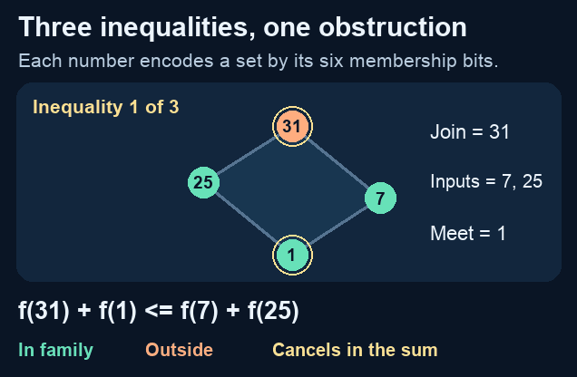

# An acyclic obstruction to submodular threshold representation

A family of nine sets on six ground elements contains the union or intersection of every pair. Its **full dependency digraph is acyclic**, but no submodular function selects exactly those nine sets by a strict threshold. The same family works inside the eighteen-element sublattice it generates.

[Paper PDF](paper/manuscript.pdf) · [LaTeX source](paper/manuscript.tex) · [Catalog Q335](https://github.com/10m-u/open-problems-catalog/blob/ca8d4d44ba3db527f19f28928c240168f545ecfe/problems/mathematics/combinatorics-graph-theory-part-1.md#q335) · [Elbracht, Kneip and Teegen, Question 4.5](https://arxiv.org/html/2103.13162v2#S4)

## Three inequalities give the contradiction

Write each set as the integer from its six membership bits. For each diamond, submodularity bounds the sum on the union and intersection by the sum on the inputs. Adding the three inequalities cancels $f(1)$, $f(12)$ and $f(31)$ and gives
$$
f(0)+f(13)+f(63)\leq f(7)+f(25)+f(44).
$$
The left sets are outside the family and the right sets are inside. A strict threshold forces the left sum to be greater.

[Download the offline explorer ZIP](https://raw.githubusercontent.com/DannyExperiments/acyclic-submodular-threshold-obstruction/v1.0.0/visualization/acyclic-submodular-threshold-obstruction-explorer.zip) · [Worked example and rendering guide](visualization/README.md)

## Proof and earlier work

The paper checks all fourteen incomparable pairs and displays a topological order for all 789 dependency arcs. Elbracht, Kneip and Teegen previously gave non-order-induced distributive examples with cycles. The paper also verifies that a related published construction of Simmons, Bansal and Cheriyan yields a second acyclic example after adjoining complements and the two extrema. The main witness uses a distinct six-element ground set and nine members. [Literature audit](audits/public_safe_reports/LITERATURE_AUDIT.md)

## Replay and citation

Run the [exact checks](REPRODUCIBILITY.md) to reproduce the corner checks, all arcs, the three-row cancellation and the literature comparison. [Review status](STATUS.md) · [Claim scope](CLAIM_SCOPE_AND_LIMITATIONS.md) · [Research disclosure](AI_DISCLOSURE.md)

DannyExperiments is the project's citation identity. [Release v1.0.0](https://github.com/DannyExperiments/acyclic-submodular-threshold-obstruction/releases/tag/v1.0.0) · [Version DOI](https://doi.org/10.5281/zenodo.24570448) · [Citation metadata](CITATION.cff)

## Lean verification

On the 64 six-bit masks, the specified nine-member family satisfies the corner condition and its dependency relation has no directed cycle. The three submodularity inequalities contradict a strict-threshold representation in the ordered algebraic interface used in the file. The correspondence with the powerset model, specialization to real values, and the eighteen-element sublattice are explained in the paper. [Lean source and replay](formalization/README.md)
